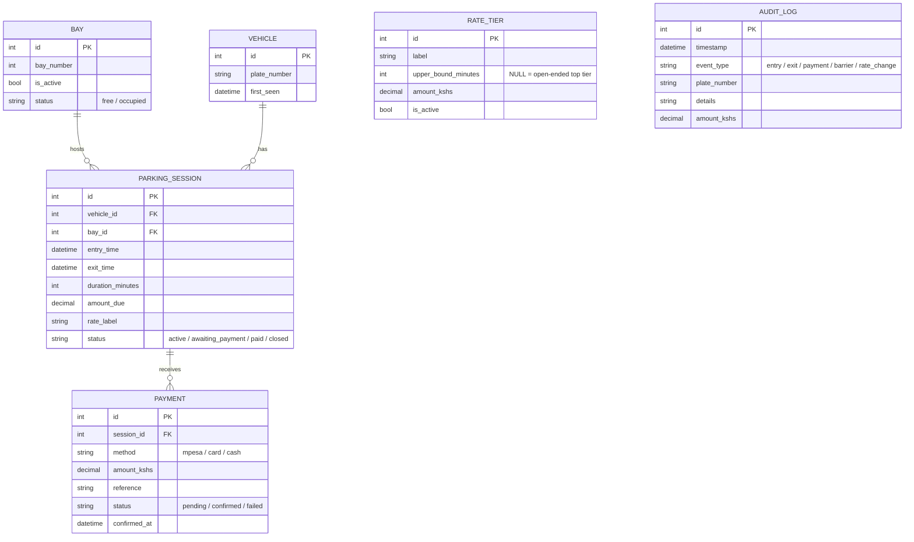

# SmartPark KE

A modern, web-based parking management system built for the MMU Data
Structures & Algorithms Task One (primer task + functional system). Built
with Python, Flask and SQLite.

---

## 1. Analysis of the client's terms of reference

Reading the brief closely, the client's request breaks down into six
capabilities, which map directly to the six modules below:

| Client requirement | Module |
|---|---|
| Show live slot availability on a board & web/mobile view | **Slot Monitoring & Display** |
| Record each vehicle on arrival with plate, time, bay | **Entry Lane Control** |
| Calculate duration & amount payable automatically at exit | **Duration & Fee Computation** |
| Collect M-Pesa / card / cash, open barrier only on confirmed payment | **Payment Collection & Barrier Control** |
| Let management change rates any time, without a software change | **Rate Configuration (Admin)** |
| *(scope)* exception handling | **Exception Handling & Manual Overrides** |
| Auditable record of every shilling collected, for reconciliation & VAT | **Administrative Reporting / Audit Trail** |

Out of scope (per the brief): online pre-booking, valet operations,
loyalty-scheme integration, automated number-plate blacklisting.

---

## 2. Module algorithms (Task, part a)

### 2.1 Slot Monitoring & Display
```
maintain a min-heap of free bay numbers and a status flag per bay
on any entry/exit event:
    recompute {free_count, occupied_count, per-bay status}
GET /api/slots polls this snapshot every 5s for the board UI
```

### 2.2 Entry Lane Control — `handle_arrival(plate)`
```
1. if plate already has an open session -> reject (duplicate)
2. bay <- free_bay_heap.allocate()        # lowest free bay number
3. if bay is None:
       overflow_queue.enqueue(plate)      # lot full, FIFO wait line
       return "queued"
4. find_or_create Vehicle(plate)
5. create ParkingSession(entry_time=now, bay=bay, status='active')
6. bay.status <- 'occupied'
7. active_sessions[plate] <- session.id   # O(1) hash-map insert
8. append AuditLog('entry', plate, bay)
9. return ticket {bay_number, entry_time}
```

### 2.3 Duration & Fee Computation — `handle_exit_lookup(plate)`
```
1. session_id <- active_sessions.get(plate)      # O(1)
2. if not found -> reject
3. duration_minutes <- (now - session.entry_time) in minutes
4. (amount, label) <- rate_table.fee_for(duration_minutes)  # binary search, O(log tiers)
5. store duration & amount on session; status <- 'awaiting_payment'
6. return {duration, amount, bay_number} to the exit screen
```

### 2.4 Payment Collection & Barrier Control — `initiate_payment(session, method)`
```
1. create Payment(session, method, amount, status='pending')
2. if method == 'cash': confirm immediately (attendant received cash)
   if method in ('mpesa','card'): call provider API / await callback
      (simulated as immediate confirm in this build for demo purposes)
3. on confirmed:
       append AuditLog('payment', plate, amount)
       call open_barrier_for(session)      # barrier code path is ONLY
                                            # reachable from here
4. on failed: session stays 'awaiting_payment'; driver may retry
```

`open_barrier_for(session)`:
```
1. bay.status <- 'free'; session.status <- 'closed'; session.exit_time <- now
2. free_bay_heap.release(bay.number)        # O(log n)
3. remove plate from active_sessions        # O(1)
4. if overflow_queue not empty: dequeue next plate, notify attendant
5. append AuditLog('barrier_open', plate, bay)
```

### 2.5 Rate Configuration (Admin)
```
RateTier rows are ordinary DB rows (label, upper_bound_minutes, amount).
Add/edit/delete via /admin/rates -> RateTable.reload() re-sorts the
in-memory tier list from the DB. No code change or redeploy required.
```

### 2.6 Exception Handling
```
Real deployments hit cases outside the happy path. Handled explicitly:

- Invalid plate input (too short/empty) -> rejected before any DB write,
  at both entry and exit.
- Exit requested for a plate only in the waiting queue (never allocated
  a bay) -> distinct message instead of a generic "not found".
- Payment decline/timeout (mpesa/card) -> session stays
  'awaiting_payment', driver can immediately retry with the same or a
  different method; a 'payment_failed' audit event is logged.
- Overstays: sessions open far longer than any realistic parking
  duration (>24h) -> surfaced on /admin/exceptions for manual review,
  instead of silently occupying a bay forever.
- Manual override: force_release(session, reason) lets an admin close a
  stuck session and free its bay outside the normal payment flow (e.g.
  a broken barrier), always logged with the reason given.
```

### 2.7 Administrative Reporting
```
AuditLog is append-only: every entry, exit, payment and rate change is
inserted, never updated or deleted. /admin/reports replays it for a
chosen date, alongside a revenue total, for reconciliation and VAT.
```

---

## 3. Data structures used, and why (Task, part b)

| Structure | Used for | Why this one |
|---|---|---|
| **Min-heap** (`heapq`) | Free-bay pool | Always allocate the lowest-numbered free bay and return a released bay — both O(log n). A sorted list would need O(n) to re-sort after every release; a heap doesn't. |
| **Hash map** (`dict`) | `plate -> open session id` | At exit we must find the matching open session from a plate scan instantly. O(1) average lookup instead of scanning every open session, O(n). |
| **Queue / deque** (`collections.deque`) | Overflow waiting line at the gate when the lot is full | FIFO is the fair, correct real-world model, and deque gives O(1) enqueue/dequeue from both ends (needed when a waiting driver gives up and leaves). |
| **Singly linked list** (custom `AuditChain`) | Append-only audit / visit history | Records are only ever appended and read sequentially (print a statement, replay for VAT) — never randomly accessed or reordered — so a linked list is a light, natural fit that also makes the "append-only, never edited" audit guarantee obvious in the code. Persisted via the `AuditLog` table; the in-memory chain mirrors it for fast sequential replay. |
| **Sorted array + binary search** (`bisect`) | Rate-tier lookup | Tiers are sorted by upper bound; finding the applicable tier for a duration is O(log n) in the tier count, and because tiers are just data rows, management can add/edit/remove them at runtime — satisfying "change rates without a software change." |

See `data_structures.py` for the implementations and full docstring
rationale, and `services/slot_manager.py` / `services/payment.py` for how
they're used by each module.

---

## 4. Dynamic database design (Task, part c)

"Dynamic" = nothing management needs to change at runtime (bay count,
rate tiers, payment methods) is hard-coded; it's all rows in tables that
the admin screens read and write.



Notes on why it's dynamic:
- **`Bay`** rows can be inserted (add more bays) or `is_active`-flagged out
  (retire a bay for maintenance) without touching code.
- **`RateTier`** rows drive `fee_for()` — editing them from `/admin/rates`
  changes pricing immediately.
- **`ParkingSession`** and **`Payment`** are append/update-only per visit,
  so a vehicle's full history survives repeat visits (`Vehicle` is
  looked up or created once per plate, never duplicated).
- **`AuditLog`** is strictly append-only, giving an immutable trail for
  reconciliation and VAT, independent of whichever session/payment rows
  it references.

---

## 5. Running the system

```bash
python -m venv venv
source venv/bin/activate          # venv\Scripts\activate on Windows
pip install -r requirements.txt
python app.py
```

Then open **http://127.0.0.1:5000/**

- `/` — live slot board (auto-refreshes)
- `/entry` — record a vehicle arrival
- `/exit` — look up a plate, see fee, pay (M-Pesa / card / cash — mocked
  gateway, see `services/payment.py`), barrier opens only on confirmation
- `/admin/rates` — add/edit/disable rate tiers at runtime
- `/admin/reports` — daily revenue & full audit trail

A SQLite file `smartpark.db` is created automatically on first run, seeded
with 20 bays and the rate tiers from the assignment brief (free up to 30
min, Kshs 50 up to 2h, Kshs 100 up to 4h, Kshs 300 up to 6h, Kshs 500 over
6h).

## 6. Project layout

```
smartpark/
├── app.py                 Flask routes (board, entry, exit, admin)
├── extensions.py          SQLAlchemy singleton
├── models.py               Database schema (part c)
├── data_structures.py     Heap / hash map / queue / linked list / bisect (part b)
├── services/
│   ├── slot_manager.py    Entry / exit / board algorithms (part a)
│   └── payment.py         Payment & barrier-gating algorithm (part a)
├── templates/              Jinja2 HTML views
├── static/style.css        Styling
└── requirements.txt
```
